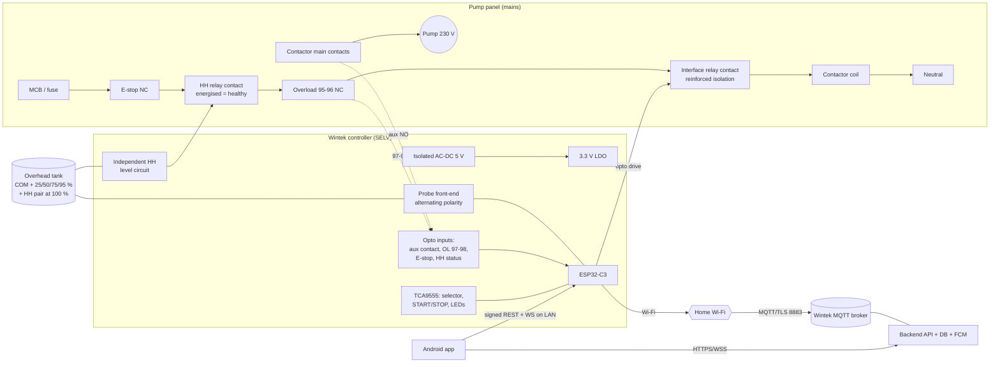

# Wintek Smart Water Tank Controller — System Architecture (Phase 1)

Wintek Solutions · Document rev 0.3 · Firmware 0.3.0

> **Status:** prototype design. This is **not** a production-ready or certified product.
> The mains-side circuits need review and sign-off by a qualified electrical engineer
> before anything is connected to a live pump. The design also needs electrical safety
> testing (IEC 60730-1 / IEC 60335-1 class of requirements), EMC/surge testing and
> reliability testing on real hardware.

---

## 1. Scope of this delivery

| Phase | Content | State |
|---|---|---|
| 1 Architecture | This document, plus [MQTT_PROTOCOL.md](MQTT_PROTOCOL.md) and [LOCAL_API.md](LOCAL_API.md) | Done |
| 2 Firmware core | Sensor front-end, level mapping, state machine, safety manager, local panel, NVS, diagnostics, unit tests | Done. Compiles for ESP32-C3; 78 host unit tests pass |
| 3 Connectivity | Wi-Fi with backoff and SoftAP provisioning, MQTT/TLS, signed local REST + WebSocket, mDNS, command ack/dedupe/expiry, OTA with signature and rollback | Done. Compiles; **not yet exercised against a broker or on hardware** |
| 4 Flutter app | — | Next |
| 5 Backend | — | Next |
| 6 Advanced | Scheduling, alerts and calibration are in the firmware. History and push notifications come with the backend | Partial |
| 7 Hardware | Interface circuits and values are below; KiCad schematic, BOM and layout are not done yet | Next |
| 8 Pilot | [TEST_PLAN.md](TEST_PLAN.md) defines the tests; none of the HIL or field tests have run | Next |

## 2. Requirements baseline and assumptions

### 2.1 Confirm these before the hardware is frozen

| Item | Assumed for this design | Why it matters |
|---|---|---|
| Contactor coil | 230 V AC, ≤ 10 VA holding, ≤ 80 VA inrush | Rating of the interface relay contact and the snubber |
| Contactor auxiliary contact | 1 NO auxiliary block fitted | Feedback supervision (welded or not pulling in) |
| Motor | ≤ 1.5 HP (1.1 kW) single phase, with a thermal overload relay (95-96 NC, 97-98 NO) | Overload input; the coil circuit opens through 95-96 |
| Neutral | Available in the panel | Isolated AC-DC supply input |
| Probe cable | ≤ 15 m at the default settle time (≤ 30 m with a longer settle time, see §4.6) | Cable capacitance limits the acquisition timing |
| Tank | One overhead tank, 300–5000 mm high, non-metallic (PVC/HDPE/concrete) | A metal tank needs an insulated common electrode and a different arrangement |
| Water | Municipal or borewell water, 50–1500 µS/cm | Wet/dry thresholds (RO or rain water needs recalibration) |
| Pump source protection | The sump/well dry-run is **not** sensed by the overhead tank probes | Covered indirectly by the "no level rise" timeout (§6.5) |

### 2.2 Key decisions

* **ESP32-C3 + Arduino-ESP32 2.0.17 (PlatformIO `espressif32@6.9.0`).** This is the newest Arduino core
  published for the official PlatformIO platform. It includes ESP-IDF 4.4.7, which provides esp-mqtt,
  mbedTLS and an app-rollback-enabled bootloader, so no extra MQTT library is needed. A full ESP-IDF
  build is recommended for production because it is the only route to flash encryption, NVS encryption
  and Secure Boot v2 (§9).
* **SoftAP provisioning instead of BLE in phase 1.** The ESP32-C3 supports BLE 5. BLE provisioning
  would cost roughly 250–300 KB of flash and a protocomm client in the app. The SoftAP is WPA2-protected
  with the per-device setup code, works with any Android phone and reuses the same signed pairing
  protocol as the LAN API. BLE remains an option once flash headroom is measured (current image:
  1.08 MB of a 1.875 MB slot).
* **Discrete level only.** The level is reported as a measured probe position plus the range the water
  is in. It is never interpolated.

## 3. System block diagram



**Authority.** Safety is layered. The **hardware chain** (E-stop, HH relay, overload) can always
de-energise the coil without the MCU. The **firmware** decides when the pump runs and supervises that
chain. The **app and the cloud** can only send requests, and the device validates each one.

## 4. Sensor architecture

### 4.1 Probe arrangement

| Electrode | Height (default, 1200 mm tank) | Purpose |
|---|---|---|
| COM | Bottom, below the lowest probe (about 50 mm above the floor, above the sludge) | Common reference and excitation electrode |
| P25 | 300 mm (25 %) | Default **ON** threshold: the pump starts when this probe goes dry |
| P50 | 600 mm (50 %) | Level indication |
| P75 | 900 mm (75 %) | Level indication |
| P95 | 1140 mm (95 %) | Default **OFF** threshold: the pump stops when this probe goes wet |
| HH-A / HH-B | Pair at 100 % (overflow lip −20 mm) | **Independent** high-high cutoff on its own cable and circuit |

That is 4 level probes, 1 common and an HH pair: **7 conductors** (two cables: a 5-core for level and
a 2-core for HH).

**Is a separate bottom/common electrode necessary?** Yes, for the level probes. The tank is
non-metallic, so the current needs a return path that is always submerged. A dedicated bottom
electrode gives a defined reference independent of the plumbing. It also lets "no probe wet" mean
"below 25 %" rather than "unknown". A metal tank or inlet pipe must **not** be used as the common: its
potential is undefined and it may be bonded to protective earth.

The **HH pair does not use COM.** Its two electrodes sit side by side at the overflow level, so the HH
function survives a broken COM wire, a failed MCU, failed firmware or a failed level front-end.

### 4.2 Threshold semantics (no interpolation)

* **ON threshold = probe k:** fill is demanded when probe k is **dry**, meaning the water fell below k.
* **OFF threshold = probe m:** fill stops when probe m is **wet**, meaning the water reached m.
* Hysteresis is implicit. After stopping at 95 % the pump stays off until the 25 % probe goes dry again.
* Thresholds can only be set to installed probe positions (by index, or by an exact percentage that
  matches a probe). `ON < OFF` is enforced.
* The reported level is `levelPercent` (highest wet probe) plus `levelRangeLow/High`. The app must
  show "50 % (50–75 %)" and must not draw a continuous level.

### 4.3 Why alternating polarity

A DC current through water electrolyses it, which plates and corrodes the electrodes, grows deposits
and drifts the readings within weeks. The front-end uses **pulsed, polarity-reversed excitation**:

```
          Phase A (~2.5 ms)      Phase B (~2.5 ms)        rest (245 ms)
EXC_COM   ‾‾‾‾‾‾‾‾‾‾‾‾‾‾‾‾‾‾‾‾\______________________/______________________
EXC_BIAS  ____________________/‾‾‾‾‾‾‾‾‾‾‾‾‾‾‾‾‾‾‾‾‾‾\______________________
```

The two phases are equal in duration and opposite in current direction, so the **net DC is about 0**.
The duty cycle is about 2 % and the peak current is about 15 µA per probe (§4.4), so electrolysis is
negligible. True sine-wave AC excitation (a CD4093 oscillator into a capacitor-coupled divider, with
synchronous rectification) was considered. It gives a similar corrosion benefit, but it needs more
parts and loses the per-phase self-test described next.

### 4.4 Front-end circuit (per level probe, values as in `include/board_config.h`)

```
EXC_COM (GPIO5) ──100R──┬──── TVS ──── COM electrode
                        └── (shared by all probes)

PROBE_n electrode ── TVS(GND) ──R_series 82k──┬───────────── ADC (GPIO0/1/3/4)
                                              ├── 1 nF ── GND
                                              ├── R_bias 220k ── EXC_BIAS (GPIO6, shared)
                                              └── R_gnd 470k ── GND
```

Two measurements, vA and vB, over-determine the single unknown, the water path resistance Rw:

* Phase A (COM = 3.3 V, BIAS = 0): `vA = V · (Rb‖Rg) / (Rs + Rw + Rb‖Rg)`. This gives Rw.
* Phase B (COM = 0, BIAS = 3.3 V): `vB = V · (Rg‖(Rs+Rw)) / (Rb + Rg‖(Rs+Rw))`. This must match the
  value predicted from Rw.

| Condition | vA | vB |
|---|---|---|
| Wet, Rw = 10 kΩ | 2045 mV | 855 mV |
| Wet, Rw = 150 kΩ | 1295 mV | 1366 mV |
| Dry (open) | 0 mV | 2248 mV |
| R_bias open | ~0 | ~0 → **SENSOR_CHAIN fault** |
| Probe shorted to supply | > limit | > limit → **fault** |
| Leakage to GND (water in the cable) | plausible | too low → **fault** |

All voltages stay below 2.25 V, inside the ESP32-C3 ADC's calibrated 11 dB range (about 0–2.5 V). The
self-test runs **even when the probe is dry**, which a simple digital "wet/dry" input cannot do. The
estimated Rw is published in diagnostics so electrode fouling can be tracked over time.

Wet/dry classification uses hysteresis (defaults: wet < 250 kΩ, dry > 500 kΩ). This covers
conductivity from about 30 to 1500 µS/cm with 6–8 mm stainless electrodes 30–100 mm from COM. Very
pure water (RO/rain) needs the thresholds raised in calibration.

### 4.5 Filtering, splash and debounce

* RC (82 k + 1 nF) plus a TVS per channel. Cable noise is rejected by sampling only after the settle
  time and by the debounce below.
* A wet↔dry change commits only after **3 s** stable (configurable 0.5–30 s). This rejects inlet
  splash and ripples. Mount the probes in a perforated stilling tube (32–40 mm PVC, slotted) away from
  the inlet jet.
* A channel FAULT commits only after **5 s**.
* Any wet probe above a dry probe means **SENSOR_SEQUENCE** (invalid). A wet reading on a channel
  configured as unused is reported in diagnostics.

### 4.6 Cable length limits

The cable's capacitance (about 100 pF/m) charges through about 150 kΩ (Thevenin), so τ ≈ 15 µs per
metre. The settle time must be at least 5τ.

| Cable | Minimum `probeSettleUs` |
|---|---|
| ≤ 15 m (default 2500 µs) | 2500 |
| 15–30 m | 4500 |
| > 30 m | Not supported. Use a remote probe buffer (op-amp at the tank) or a dedicated level-relay IC |

Use unscreened multi-core PVC cable away from mains cables. If screened cable is used, earth the
screen at the controller end only.

### 4.7 Stainless-steel probe limitations (state these to customers)

* Deposits (calcium, iron, biofilm) raise the contact resistance over months. Clean the probes every
  6–12 months, or when the diagnostic Rw trend rises past about 50 % of the wet threshold.
* Foam, condensation films or wet spider webs bridging COM and a probe can read as "wet" at very high
  resistance. The dry threshold of 500 kΩ rejects most of these.
* **Disconnected probes cannot always be detected.** A broken probe wire reads as dry. The front-end
  self-test proves the board side of the channel, not the cable beyond the probe. It is caught
  indirectly by (a) an impossible sequence (a higher probe wet while the broken one reads dry) and
  (b) the no-level-rise timeout and maximum runtime while filling. A **broken P95 wire while P75 is
  wet cannot be distinguished from "between 75 and 95 %"**. That is why the independent HH cutoff is
  mandatory.
* Use 316 stainless (not 304) in chlorinated water. Never use copper or brass.

### 4.8 Calibration (firmware + app)

Persisted in NVS (`DeviceConfig`) and validated (`validateConfig`):

* Tank height (300–5000 mm), capacity, probe count (2–4) and probe heights in mm. Heights must be
  ascending, at least 50 mm apart, and the top probe at least 30 mm below the tank top (room for HH).
* Logical mapping is `percent = round(height / tankHeight × 100)`. The thresholds refer to probes.
* Sensitivity (wet/dry kΩ with at least 25 % hysteresis), settle time, debounce, fault-confirm and
  recovery times.
* Diagnostics (`/api/v1/diagnostics`): per-channel vA, vB, Rw, instantaneous and committed state.

## 5. GPIO allocation (ESP32-C3, verified against the chip constraints)

The ESP32-C3 has GPIO0–21. GPIO11–17 belong to the SPI flash or VDD_SPI on the modules. GPIO18/19 are
native USB (console and flashing). GPIO2, 8 and 9 are strapping pins. Only ADC1 (GPIO0–4) can be used
while Wi-Fi is active.

| GPIO | Function | Dir | Notes |
|---|---|---|---|
| 0 | PROBE_25 | ADC1_CH0 | XTAL_32K_P. No 32 kHz crystal is fitted |
| 1 | PROBE_50 | ADC1_CH1 | XTAL_32K_N |
| 3 | PROBE_75 | ADC1_CH3 | |
| 4 | PROBE_95 | ADC1_CH4 | MTMS (pad JTAG unused, USB-JTAG instead) |
| 5 | EXC_COM | out | 100 Ω to the COM electrode. Driven LOW in `earlySafeInit()` |
| 6 | EXC_BIAS | out | Shared 220 k bias network |
| 10 | CONTACTOR_DRIVE | out | 10 k pull-down; opto LED needs over 1 mA, so weak reset pulls cannot energise it |
| 7 | CONTACTOR_FB | in | Opto from the contactor aux NO, active LOW |
| 20 | OVERLOAD_IN | in | Opto from OL 97-98, active LOW (U0RXD, input only) |
| 8 | I2C SDA | od | 4.7 k pull-up keeps the strap high. The DevKitM-1 RGB LED shares this pin (cosmetic only) |
| 2 | I2C SCL | od | 4.7 k pull-up keeps the strap high |
| 9 | SERVICE button | in | The BOOT button. Pressing it at reset enters the ROM downloader |
| 18/19 | USB D−/D+ | — | Console, flashing |
| 21 | U0TXD | — | ROM boot log, kept free |

The design needs 16 functions but only 11 GPIOs are safe to use, so a **TCA9555** (I²C, 0x20)
carries the non-time-critical HMI. Every motor-switching and protective function stays on direct GPIO.

| TCA9555 | Function |
|---|---|
| P0.0 / P0.1 | Selector AUTO / MANUAL contact (neither closed = OFF; both closed = fault, treated as OFF) |
| P0.2 | START button (NO) |
| P0.3 | STOP button (**NC** to GND; a broken wire reads as STOP) |
| P0.4 | HH relay status (tripped) |
| P0.5 | E-stop status |
| P0.6 | HH circuit healthy |
| P1.0–P1.3 | LED Wi-Fi, LED Motor, LED Fault, buzzer (the power LED is wired to the supply) |

**If the expander cannot be read**, the selector is treated as **OFF**: the motor stops, a
LOCAL_PANEL_FAULT alert is raised and the fault LED blinks. The E-stop and HH status inputs are
informational because both are wired into the coil circuit, so losing them does not remove protection.

## 6. Safety architecture and motor state machine

### 6.1 Protection layers

| # | Hazard | Primary (hardware, no MCU) | Secondary (firmware) |
|---|---|---|---|
| 1 | Overflow | HH relay (energised-when-healthy, latching, manual reset) opens the coil circuit | Stop at the OFF probe; OVERFLOW_LOCKOUT on the HH status input |
| 2 | Motor overload | Thermal OL 95-96 opens the coil | OL 97-98 input causes FAULT_LOCKOUT (MOTOR_OVERLOAD) |
| 3 | Emergency | E-stop NC in the coil circuit | Status input causes FAULT_LOCKOUT (EMERGENCY_STOP) |
| 4 | Welded contactor | — (needs upstream MCB isolation) | Aux feedback closed while commanded OFF: CONTACTOR_WELDED, critical alert |
| 5 | Contactor or coil failure | — | Commanded ON with no feedback: CONTACTOR_NO_PULL_IN; feedback lost while running: CONTACTOR_DROPOUT |
| 6 | Dry run, no supply, leak | — | No level increase within 20 min: NO_LEVEL_RISE; runtime over 60 min: MAX_RUNTIME |
| 7 | Sensor failure | — | Invalid level stops the pump (SENSOR_FAULT); auto-recovers after 10 s valid |
| 8 | Short cycling | — | Minimum OFF time 120 s, at most 6 starts per hour, 3 s debounce |
| 9 | MCU hang or crash | Drive pull-down, so the output is OFF while in reset | Task watchdog 15 s with panic reset; brown-out reset |
| 10 | Remote misuse | — | Device-side validation of every command; manual ON can never bypass items 1–7 |

The HH relay is **energised when healthy**. If the HH circuit loses power or fails, its contact opens
and the pump cannot run. It latches open on a trip until its local reset button is pressed.

### 6.2 States

| State | Motor | Entered when | Leaves when |
|---|---|---|---|
| BOOT_SELF_TEST | OFF | Power-up, EXIT_OTA | After `max(restartDelay, 3 s)`: to the restored latch → lockout, an invalid level → SENSOR_FAULT, otherwise → idle for the mode |
| AUTO_IDLE | OFF | AUTO with no fill demand, or demand waiting on timing guards | Demand and guards OK → AUTO_FILLING; demand with the window closed → SCHEDULE_WAIT |
| AUTO_FILLING | ON | Fill demand and start permitted | OFF probe wet → AUTO_IDLE (TANK_FULL); window end → SCHEDULE_WAIT; user OFF → AUTO_IDLE (inhibit); fault → lockout or sensor fault |
| SCHEDULE_WAIT | OFF | Demand exists but the schedule window is closed | Window opens → AUTO_FILLING; demand cleared → AUTO_IDLE |
| MANUAL_IDLE | OFF | MANUAL or OFF mode | MOTOR_ON accepted → MANUAL_RUNNING |
| MANUAL_RUNNING | ON | Manual start | OFF probe wet, user OFF, mode change or fault |
| SENSOR_FAULT | OFF | Level invalid (sequence, channel, stale) | Valid for `sensorRecoveryMs` (10 s) → idle for the mode |
| OVERFLOW_LOCKOUT | OFF | HH status tripped | RESET_FAULT, only once HH has cleared (**latched across reboot**) |
| FAULT_LOCKOUT | OFF | Overload, E-stop, contactor fault, MAX_RUNTIME, NO_LEVEL_RISE | RESET_FAULT, only once the condition has cleared (**latched across reboot**) |
| OTA_MAINTENANCE | OFF | ENTER_OTA accepted (motor off, feedback confirms OFF) | Reboot into the new image, or EXIT_OTA → BOOT_SELF_TEST |

Evaluation order on every 20 ms tick (`MotorStateMachine::update`):
equipment fault → overflow → lockout hold → OTA hold → boot self-test → sensor fault → mode → AUTO/MANUAL logic.

### 6.3 AUTO and MANUAL interaction

The physical selector has the **final** say:

| Selector | Effective mode | Remote (app/cloud) | Local START/STOP |
|---|---|---|---|
| OFF | OFF: motor locked off | ON and SET_MODE rejected (`LOCAL_SWITCH_OFF`); OFF accepted | STOP only |
| AUTO | Software mode (AUTO or MANUAL, chosen in the app, persisted) | Full control | START = "fill now", STOP = user OFF |
| MANUAL | MANUAL (local) | ON rejected (`LOCAL_SWITCH_MANUAL`); OFF accepted | START/STOP |

* **MOTOR_ON in AUTO** means "fill now". It sets fill demand, ignores the schedule window, and stops
  at the OFF probe as usual.
* **MOTOR_ON with `"mode":"MANUAL"`** switches the software mode to MANUAL and starts the pump.
* **MOTOR_OFF in AUTO** stops the pump and **inhibits automatic restart** for 30 minutes
  (`autoResumeAfterUserOffMs`), or until the tank completes a cycle or the user sends ON or AUTO.
  Without this, the pump would restart two minutes after the user stopped it.
* **Switching AUTO → MANUAL while filling** stops the pump; manual operation needs an explicit start.
  **Switching MANUAL → AUTO while running** continues as an automatic fill to the OFF probe without
  cycling the contactor.
* **MOTOR_OFF is always accepted** from every source and in every state.
* **A manual run still stops at the OFF probe.** Manual ON is rejected when the tank is full, during
  overflow, overload, E-stop or a sensor fault, in any lockout, during min-OFF or the start-rate
  limit, and during the boot restart delay.

### 6.4 Timing defaults

| Parameter | Default | Range | Justification |
|---|---|---|---|
| Sensor debounce | 3 s | 0.5–30 s | Longer than typical inlet splash and ripple bursts; well below the fill time between probes (minutes) |
| Sensor fault confirm | 5 s | 1–60 s | Rejects single ESD or noise events |
| Sensor recovery | 10 s | 2–300 s | Avoids flapping on an intermittent connection |
| Minimum ON | 60 s | 0–600 s | Applied only to schedule-window stops. Safety, level and user stops are always immediate |
| Minimum OFF | 120 s | 30 s–30 min | Contactor and motor thermal recovery, and pipe pressure equalisation. A 30 s floor is enforced |
| Max starts per hour | 6 | 1–30 | Typical small single-phase motor duty limit (check the motor datasheet) |
| Max runtime | 60 min | 5 min–4 h | Set to about 1.5× the measured full fill time (calibrate at installation) |
| No-rise timeout | 20 min | 2 min–max runtime, or 0 = off | Longest expected time between adjacent probes plus margin |
| Contactor feedback timeout | 2 s | 0.5–10 s | Pull-in and drop-out are under 100 ms; allows for slow AC coils |
| Restart delay after boot | 30 s | 5 s–10 min | Lets the supply settle after an outage and staggers neighbourhood restarts |
| User-OFF auto inhibit | 30 min | 1 min–24 h | Respects an explicit user stop |

At 80 % of the maximum runtime a `RUNTIME_WARNING` alert is raised.

### 6.5 Power failure, watchdog and brown-out

On every boot:

1. `BoardIo::earlySafeInit()` drives the contactor output LOW before anything else runs.
   During reset, the 10 k pull-down holds the opto LED off.
2. The task watchdog is set to 15 s with panic reset. Configuration, the persisted software mode,
   the latched fault and the counters are restored. **A manual ON is never restored.**
3. BOOT_SELF_TEST waits for the restart delay with the motor off and checks the sensors. If the
   contactor feedback reads closed while commanded off for 2 s, the result is CONTACTOR_WELDED.
4. A latched overflow or equipment fault from before the reboot is re-entered, so a power cycle
   cannot clear a lockout.
5. The reset reason is logged and published (`resetReason`). A power-on or brown-out reset raises a
   `POWER_RESTORED` alert.

* **Watchdog.** The control and network tasks are both subscribed. A hang in either resets the chip,
  the reset de-energises the drive, and the boot sequence above applies.
* **Brown-out.** The ESP32-C3 brown-out detector (enabled in the SDK) resets the chip on supply sag.
  The interface relay drops out at low voltage anyway. The HH relay is energised-when-healthy, so a
  collapsing 5 V supply also opens the coil circuit.

## 7. Firmware architecture

```
firmware/
  platformio.ini, partitions_wintek_4MB.csv
  include/  board_config.h (pins), app_config.h (constants), ota_pubkey.h
  src/
    core/Types.*                 enums, codes, string mapping (pure)
    sensors/ProbeSensor.*        phase math, classification, debounce (pure)
    sensors/LevelEstimator.*     discrete level, sequence validation (pure)
    motor/SafetyManager.*        feedback, runtime, no-rise, trips (pure)
    motor/MotorStateMachine.*    FSM, commands, events (pure)
    motor/MotorController.*      applies output, runtime counters
    storage/Config.*             model, defaults, validation (pure)
    storage/ConfigJson.*         JSON mapping (pure)
    storage/ConfigStore.*        NVS persistence
    services/ScheduleManager.*   windows + fill schedules (pure)
    services/CommandProcessor.*  envelope parse, expiry, dedupe (pure)
    services/AlertManager.*      events → alerts, repeat suppression (pure)
    services/OtaManifest.*       manifest validation, semver (pure)
    services/OtaManager.*        HTTPS download, SHA-256, ECDSA, rollback
    services/TimeService.*       SNTP, timezone
    connectivity/WiFiManager.*   STA backoff, SoftAP provisioning
    connectivity/MqttManager.*   esp-mqtt, TLS, LWT, backoff, reassembly
    connectivity/LocalAuth.*     pairing, nonces, HMAC request signing
    connectivity/LocalApi.*      REST :80, WebSocket :81, mDNS
    hal/BoardIo.*, hal/ProbeFrontEnd.*
    app/ControlTask.*            20 ms motor authority loop
    app/NetworkTask.*            connectivity orchestration, ApiBackend
    app/SharedState.*            snapshot, command bridge, alert queue
    app/StateJson.*, app/SerialConsole.*
    diagnostics/Logger.*
  test/  test_state_machine, test_safety, test_sensors, test_thresholds,
         test_schedule, test_commands, test_config_json
```

Everything marked *pure* compiles on the host and is unit-tested. The control task owns the GPIOs
and the state machine. The network and OTA tasks only read snapshots and submit commands through a
queue, with a task-notification reply.

## 8. Communication design (summary)

* **Cloud:** MQTT 3.1.1 over TLS on port 8883, with a per-device identity. See
  [MQTT_PROTOCOL.md](MQTT_PROTOCOL.md).
* **LAN:** REST for commands and config, plus a WebSocket for live state. Every call is
  HMAC-signed with a single-use nonce. See [LOCAL_API.md](LOCAL_API.md).
* **Same rules on both paths.** Both go through `NetworkTask::handleCommand`, which parses the
  command, checks freshness, deduplicates by `commandId`, then runs `MotorStateMachine::handleCommand`.
  The app uses one `commandId` per user action. If it retries the same command on the other path, the
  device returns the cached ack (`DUPLICATE`) and does not execute it again.
* **Path selection in the app:** prefer the LAN when the device answers `/api/v1/info` over mDNS
  within 1.5 s and the WebSocket is authenticated. Otherwise use the cloud. If the LAN fails mid-command,
  retry once via the cloud with the same `commandId`.

**LAN security limitation.** Local HTTP is not encrypted. The HMAC gives authenticity, integrity and
replay protection, but someone on the same Wi-Fi can read the level, state and configuration
contents. Wi-Fi passwords sent to `/api/v1/wifi` should only be sent over the WPA2 provisioning AP or
a trusted home network. TLS on the device (self-signed, with the certificate pinned at pairing) is a
possible phase 6 upgrade. It costs about 40 KB of RAM per session.

## 9. Security

| Asset | Protection |
|---|---|
| Wi-Fi and MQTT credentials, pairing tokens | NVS. **Production requires flash encryption + NVS encryption** (ESP-IDF build); the `nvs_keys` partition is already reserved |
| Firmware authenticity | ECDSA-P256 signature over the image SHA-256, checked before the boot partition is switched. Plus Secure Boot v2 in production |
| Broker identity | CA certificate provisioned at the factory. The firmware refuses non-TLS URIs and refuses to connect without a CA |
| Device identity | Per-device username and password, or mTLS client certificate and key (preferred). Provisioned over the USB console at end-of-line, then `factory lock` |
| LAN control | Pairing requires physical access (service button or provisioning AP) plus the setup code. The token is never sent in clear. Failed attempts lock pairing out for 5 minutes |
| Commands | Expiry at most 120 s, clock-skew check, idempotent dedupe, retained messages ignored |

The development fallback setup code is derived from the MAC. That is **not** acceptable for
production: provision a random code of 12 or more characters per unit.

## 10. OTA

1. A command `OTA_UPDATE` arrives with the manifest: version, https URL, sha256, signature, size and
   hwRev.
2. The firmware validates the manifest: newer semver, matching hardware revision, size within the
   partition, and a signing key present.
3. `ENTER_OTA` stops the motor, waits for the contactor feedback to read OFF (with retries), and
   enters OTA_MAINTENANCE.
4. The image streams over HTTPS (CA verified, no redirects) into the inactive slot while SHA-256 is
   computed. The download aborts if maintenance mode is lost (for example, a safety trip) or stalls.
5. The firmware compares the hash, verifies the ECDSA signature, then calls `Update.end()`, which
   validates the image and switches the boot partition.
6. Reboot. The new image starts in PENDING_VERIFY (the bootloader rollback is enabled in the 2.0.17
   C3 SDK). After 60 s in which the control loop is running, the state machine has left boot and the
   probes are producing data, the image is marked valid. A crash or watchdog reset before that rolls
   back to the previous image, and `ota/status` reports `ROLLED_BACK`.
7. If power is lost during the download, the old slot is still the boot slot, so nothing changes.

Partitions (4 MB): `nvs_keys` 4 KB, `otadata` 8 KB, `app0` and `app1` 1.875 MB each, `nvs` 128 KB,
`coredump` 64 KB. Current image: about 1.08–1.14 MB (58 % of a slot).

## 11. Milestones

| # | Milestone | Exit criteria |
|---|---|---|
| M1 | Bench firmware on DevKitM-1 + breadboard front-end | Probe Rw within ±20 % on 10 k/100 k/1 M test resistors; all state-machine paths shown with switches |
| M2 | Connectivity integration | Mosquitto TLS on a VPS; commands acked in under 1 s on the LAN and under 3 s via cloud; 24 h soak with no leaks (minFreeHeap stable) |
| M3 | Flutter app MVP | Pairing, dashboard, control with ack-gated UI, thresholds |
| M4 | Backend MVP | Auth, ownership, command routing, history, FCM |
| M5 | PCB rev A | Schematic reviewed by an electrical engineer; hipot and creepage verified; HIL rig |
| M6 | Pilot (10–20 sites) | 30 days without a safety incident; corrosion and Rw trend data collected |
